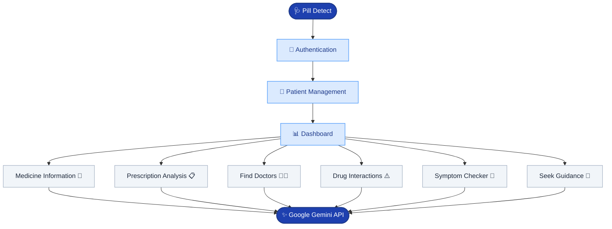

# 🩺 Pill Detect

**An AI-powered medical assistant for medicine identification, prescription analysis, symptom assessment, medication information, and healthcare discovery.**

**Live Demo:** [sonickajadeesh.github.io/pill-detect](https://sonickajadeesh.github.io/pill-detect/)

## Overview

Pill Detect is a browser-based AI medical assistant built with Rust and Dioxus. It combines AI-powered medical information retrieval, patient management, prescription analysis, interactive symptom assessment, and healthcare discovery in a single application. The application uses Google Gemini for AI-powered functionality and Firebase Authentication for user authentication.

### Key Features

- 👤 Patient registration and management
- 💊 AI-powered medicine identification from images
- 🔎 Medicine information and search history
- 📋 Prescription image analysis and management
- 💬 Conversational health guidance
- 🩻 Interactive body-map symptom checker
- ⚠️ Drug interaction checking
- 🧑‍⚕️ Doctor and specialist discovery
- 📍 Location-based healthcare discovery
- 🔐 Firebase email/password authentication
- 💾 Browser-based persistent storage

Pill Detect is intended for informational and educational purposes and is not a replacement for qualified healthcare professionals.

## ✨ Features

### 👤 Patient Management

Create and manage individual patient profiles. Each patient profile includes:

- First and last name
- Date of birth
- Sex
- Blood group
- Height and weight
- Known allergies
- Existing medical conditions

Patient profiles can be created, viewed, edited, and deleted. Each patient maintains separate records, including medicine search history, conversations, prescriptions, and drug interaction history.

### 💊 Medicine Identification

Identify medicines using an uploaded image of a tablet, capsule, or medicine packaging. Gemini's multimodal capabilities are used to analyze the image and retrieve relevant information, potentially including:

- Medicine name
- Generic name
- Strength
- Manufacturer or product details
- Other identifiable medication information

The identified medicine can subsequently be used to retrieve more detailed medication information.

> **Important:** Image-based medicine identification is not guaranteed to be accurate. Always verify the medicine against its original packaging or prescription and consult a pharmacist before taking unidentified medication.

### 🔎 Medicine Information

Search for medicines to retrieve relevant medication information. Information may include:

- Brand and generic names
- Medical uses
- Dosage information
- Common side effects
- Warnings and precautions
- Prescription requirements

Medicine searches are powered by Gemini and use instructions designed to prioritize reliable medical information rather than generate unsupported answers. Previous medicine searches are saved in the corresponding patient's search history.

### 📋 Prescription Analysis and Management

Upload an image of a medical prescription and use AI-powered image analysis to extract prescribed medications. The analysis can identify:

- Medicine names
- Strength
- Dosage
- Duration
- Administration instructions

Extracted prescription information can be saved to the patient's profile 
Prescriptions can subsequently be viewed, edited, and deleted.

**Prescription Expiration Management**

Prescription expiration is managed manually using an active/expired toggle. This allows users to manage prescription status without requiring an expiry date.

### 🩻 Interactive Symptom Checker

Pill Detect includes an interactive human body map that allows users to identify where they are experiencing symptoms. Users can:

1. Select an anatomical region using the interactive body map.
2. Alternatively, select a body part using the searchable body-part selector.
3. Choose relevant symptoms associated with the selected region.
4. Add additional symptoms when necessary.
5. Submit the selected symptoms for AI-powered assessment.

The application uses Gemini to provide informational guidance based on the selected symptoms. The body map supports multiple anatomical regions, including the head, face, neck, chest, abdomen, back, arms, hands, legs, and feet.

### 💬 Conversational Health Guidance

The health guidance feature provides an AI-powered conversational interface for medical and health-related questions. Features include:

- Conversational medical assistance
- Patient-specific conversation history
- Context-aware responses
- Persistent conversations
- Markdown-formatted responses

The AI is instructed to communicate responsibly, avoid unsupported diagnoses, acknowledge uncertainty, and recommend professional medical attention when appropriate.

### ⚠️ Drug Interaction Checker

Check multiple medications for potential drug interactions and safety concerns. The interaction checker considers:

- Drug-to-drug interactions
- Potential adverse effects
- Interaction severity
- Relevant safety precautions
- Patient allergies
- Existing medical conditions
- Recommended actions

Interaction searches can be saved to the patient's interaction history for future reference.

### 🧑‍⚕️ Find Doctors

Find healthcare professionals and specialists based on their medical specialization and location. Available specialties include:

- General Physician
- Cardiologist
- Dermatologist
- Neurologist
- Pediatrician
- Orthopedic
- Psychiatrist
- Gynecologist
- Dentist
- ENT
- Ophthalmologist

Users can enter a location manually or use device geolocation to help determine their current location. The application uses AI-powered search functionality to retrieve relevant doctor information.

## 🧠 Application Architecture

Pill Detect uses a modular Rust and Dioxus architecture. The application separates its user interface, API communication, authentication, data management, geolocation, and AI prompt definitions into dedicated modules.



### AI Architecture

Google Gemini powers the application's AI functionality. The application communicates directly with the Gemini API using HTTP requests through `reqwest`. Text-based requests and multimodal image requests are handled separately.

### Project Structure

```text
pill-detect
│
├── .github
│   └── workflows
│
├── assets
│
├── src
│   │
│   ├── components
│   │   ├── auth.rs
│   │   ├── checker.rs
│   │   ├── dashboard.rs
│   │   ├── footer.rs
│   │   ├── guidance.rs
│   │   ├── homepage.rs
│   │   ├── information.rs
│   │   ├── interaction.rs
│   │   ├── navbar.rs
│   │   └── prescription.rs
│   │
│   ├── modules
│   │   ├── api.rs
│   │   ├── bodymap.rs
│   │   ├── database.rs
│   │   ├── firebase_auth.rs
│   │   ├── geolocation.rs
│   │   ├── prompts.rs
│   │   └── utilities.rs
│   │
│   └── main.rs
│
├── Cargo.toml
├── Dioxus.toml
├── build.rs
└── tailwind.css
```

## 🛠️ Tech Stack

| Technology | Purpose |
|---|---|
| Rust | Application programming language |
| Dioxus | Reactive UI framework |
| Dioxus Router | Client-side routing |
| Tailwind CSS | UI styling |
| Google Gemini API | AI and multimodal image analysis |
| Firebase Authentication | User registration and authentication |
| Serde JSON | Data serialization |
| Reqwest | HTTP requests |
| Gloo Storage | Browser-based persistent storage |
| Dioxus Geolocation SDK | Device geolocation |
| Dotenvy | Environment variable handling |
| WebAssembly | Web application runtime |
| GitHub Actions | Automated deployment |
| GitHub Pages | Application hosting |

## 🔑 API Configuration

Pill Detect requires two API configurations.

### 1. Google Gemini API

A Gemini API key is required for AI-powered features. When the application needs an API key, it prompts the user to enter one. The key is stored in browser `localStorage` and reused for subsequent requests.

You can obtain an API key from: [Google AI Studio – Get API Key](https://aistudio.google.com/apikey)

The stored Gemini API key can be cleared or replaced from the application dashboard.

### 2. Firebase API Key

Firebase Authentication is used for email/password registration and sign-in. To configure Firebase:

1. Create a project in [Google Firebase](https://console.firebase.google.com/).
2. Register a web application.
3. Enable Email/Password authentication under Authentication settings.
4. Obtain the Firebase Web API key.

The Firebase API key is supplied through the `FIREBASE_API_KEY` environment variable during compilation.

## 🧭 Application Routes

The application uses Dioxus Router for patient-specific navigation.

| Route | Purpose |
|---|---|
| `/` | Authentication and patient homepage |
| `/:patient_id/` | Patient dashboard |
| `/:patient_id/symptoms` | Interactive symptom checker |
| `/:patient_id/doctors` | Find doctors and specialists |
| `/:patient_id/guidance` | Conversational health guidance |
| `/:patient_id/information/` | Medicine information and identification |
| `/:patient_id/interaction/` | Drug interaction checker |
| `/:patient_id/prescriptions/` | Prescription analysis and management |

## 🔐 Privacy and Data Storage

Pill Detect uses browser-based storage for patient records and associated application data. The following information is stored locally using browser `localStorage`:

- Patient profiles
- Medicine search history
- Health guidance conversations
- Prescription records
- Drug interaction history
- Gemini API key
- Firebase authentication session

Firebase is used for authentication; patient medical records are not currently stored in a remote patient database.

> **Security Considerations:**
> - Browser-local data is not equivalent to secure medical record storage.
> - Clearing browser storage can remove locally stored patient information.
> - Gemini API requests are made directly from the client-side application.
> - API credentials stored or used in a client-side application should not be considered secret.
> - Avoid entering sensitive medical information into environments you do not trust.
>
> For production healthcare applications, sensitive data and API credentials should be handled through a properly secured backend.

## 🚀 Deployment

Pill Detect is configured for a Dioxus Web build and deployment to GitHub Pages. GitHub Actions is used to automate the deployment process.

**Live Application:** [sonickajadeesh.github.io/pill-detect](https://sonickajadeesh.github.io/pill-detect/)

## 🔧 Development Setup (Windows)

The following instructions describe how to set up Pill Detect on Windows using Chocolatey.

### Step 1: Install Chocolatey

Open PowerShell as Administrator and execute:

```powershell
Set-ExecutionPolicy Bypass -Scope Process -Force; [System.Net.ServicePointManager]::SecurityProtocol = [System.Net.ServicePointManager]::SecurityProtocol -bor 3072; iex ((New-Object System.Net.WebClient).DownloadString('https://community.chocolatey.org/install.ps1'))
```

### Step 2: Install Git, Rust and VS Code

Execute:

```powershell
choco install -y git rustup.install vscode
```

Restart PowerShell after installation.

### Step 3: Configure Rust

Install the GNU stable toolchain:

```powershell
rustup toolchain install stable-x86_64-pc-windows-gnu
rustup default stable-x86_64-pc-windows-gnu
```

Install the WebAssembly compilation target:

```powershell
rustup target add wasm32-unknown-unknown
```

Verify the installation:

```powershell
rustc --version
cargo --version
rustup show
```

### Step 4: Install Dioxus CLI

Install the Dioxus command-line interface:

```powershell
cargo install dioxus-cli
```

Verify the installation:

```powershell
dx --version
```

### Step 5: Clone the Repository

Clone the project:

```powershell
git clone --depth=1 https://github.com/sonickajadeesh/pill-detect.git
```

Navigate into the project directory:

```powershell
cd pill-detect
```

Open the project in VS Code:

```powershell
code -r .
```

Alternatively, open the project directory manually through VS Code.

### Step 6: Configure Environment Variables

Create a `.env` file in the project's root directory. Add your Firebase API key:

```env
FIREBASE_API_KEY=your-firebase-api-key
```

Replace the placeholder with the Web API key obtained from your Firebase project.

> **Important:** `.env` is flagged in `.gitignore` and should not be committed.

### Step 7: Build the Project

Open the integrated VS Code terminal using `Ctrl + Shift + ~`

Check that the project dependencies compile:

```powershell
cargo check
```

### Step 8: Run the Application

Start the local development server:

```powershell
dx serve
```

Dioxus will serve to [localhost:8080/pill-detect](http://127.0.0.1:8080/pill-detect) by default. Open the address in your browser to access the web app.

## ⚠️ Disclaimer

Pill Detect is an AI-assisted informational application.

It does not provide professional medical diagnosis, treatment, or emergency medical advice. AI-generated medical information, symptom assessments, medicine identification, and prescription analysis may be incomplete, inaccurate, outdated, or inappropriate for a particular patient.